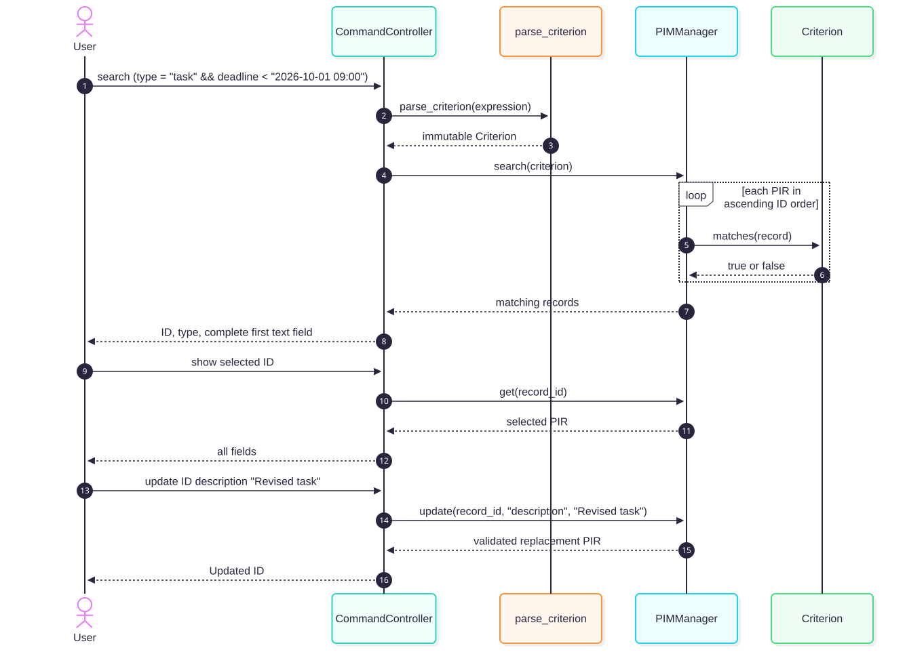

# PIM Design Document

**Course:** COMP3211 Software Engineering, Fall 2026 
**Project:** Command-line Personal Information Management system 
**Group number:** 89 
**Members and student IDs:** [Human input pending: member names and student IDs] 
**Version/date:** Usability release candidate 1.5, 2026-10-23 
**Implementation basis:** Current candidate source and tests, including local review changes. Historical starting commit: `4d3508db0447a3ac6346a2a2789da89208f88fd5`; the candidate manifest identifies the delivered files.

This document describes the architecture and public interfaces present in the current candidate source. It maps the behavior in [SRS.md](../srs/SRS.md) and the product choices in [decisions.md](../../decisions.md) to code. The companion [technical contract](TECHNICAL_CONTRACT.md) records the interface contract reconciled with the current source, which is the authority for implementation details. Class/module names are group design choices; the official Project Description requires design explanations and diagrams but does not prescribe these names.

## 1. Introduction

The PIM manages note, task, event, and contact records in one local command-line program. The implementation isolates user interaction, in-memory behavior, and `.pim` persistence so model unit tests exercise records, CRUD, and search without terminal or file I/O. This supports the official requirement to place all model code in a separate `model` package. The candidate `src/` tree contains the working implementation and uses Python standard-library modules only.

## 2. Architecture and rationale

*Figure 1. High-level architecture. Editable source: [architecture.mmd](diagrams/architecture.mmd).*

The generic pattern is **layered, MVC-style separation**. The terminal presentation and command interpretation form the view/controller boundary in `controller`. `model` owns PIR types, validation, ID allocation, search parsing/evaluation, and the collection. `storage` is a file adapter for versioned `.pim` snapshots. `src/main.py` only creates the initial manager and controller. This keeps the model independent of terminal and file I/O, making the official model unit-test deliverable practical. A full GUI-oriented MVC framework would add unnecessary parts to this local CLI.

Arrows in Figure 1 show dependencies and the labelled external data exchanges; the storage-to-model arrow means storage constructs and validates model state, not that it returns a manager to the model package. The returned manager goes to the controller. Specifically, the user talks only to the CLI; the controller invokes model operations and the file adapter; storage constructs or reads validated model state; only storage touches the local `.pim` file. On load, storage returns a **new** manager and the controller swaps its active reference only after full validation. On failure the current manager is untouched. No reused third-party architectural component is assumed; the Python standard library supplies basic dates, JSON, paths, and file replacement.

### 2.1 Alternatives and trade-offs

A single command-processing module would require less initial code, but would mix input parsing, record rules and file writes, making model-only tests and failure handling harder to isolate. The chosen separation adds explicit calls between components in return for independently testable model behavior. A database or full application framework would add setup and persistence concepts beyond the required local `.pim` workflow.

Records are immutable values: an update validates a replacement before publishing it. This makes rollback unnecessary for an invalid field, at the cost of allocating a replacement object. Search scans the collection in ID order; this is a simple choice for the required local application, not a claim of a measured capacity or response-time guarantee. Adding an index would require rules for keeping it consistent after updates, deletion and load.

## 3. Main code components and relationships

*Figure 2. Main classes, modules, and their call and ownership relationships. Editable source: [components.mmd](diagrams/components.mmd). Public fields and complete signatures, returns, and exceptions are detailed below.*

The component diagram shows `PIMManager` holding four PIR classes and calling criteria through their abstract `Criterion.matches` interface. Dependency arrows show calls and returned state, not inheritance: the controller calls the manager, search parser, and storage; storage constructs a replacement manager. The abstract `Criterion` base class has immutable type, text, time, AND, OR, and NOT implementations, listed in the lower node. The parser builds those nodes without evaluating input as Python code. No reverse dependency from `model` to `controller` or `storage` exists in the current imports. The class fields, inheritance, signatures, and exceptions appear in the tables that follow so the relationships remain readable on a document page.

### 3.1 Record types and shared fields

`Record` means `Note | Task | Event | Contact`; `RecordType` is the four literal type names. `TextField` is `text | description | name | address | mobile_number`, and `TimeField` is `deadline | start_time | alarm_time` (literal string unions, not arbitrary attributes). These type aliases define the allowed fields used in the signatures below.

All four records are frozen dataclasses. Each has a positive `id: int` and a read-only canonical `type: RecordType` property. Each constructor validates and trims accepted text in `__post_init__`; it rejects wrong field types, blank/multiline or non-UTF-8-encodable text, aware or non-minute datetimes, and invalid IDs with `ValidationError`. Normal creation still goes through the manager, which validates before allocating an ID. The data fields are:

| Class and constructor signature | Data fields | Return / possible exception |
|---|---|---|
| `Note(id: int, text: str) -> Note` | `text: str` | `Note`; `ValidationError` |
| `Task(id: int, description: str, deadline: datetime) -> Task` | `description: str`, `deadline: datetime` | `Task`; `ValidationError` |
| `Event(id: int, description: str, start_time: datetime, alarm_time: datetime) -> Event` | `description: str`, `start_time: datetime`, `alarm_time: datetime` | `Event`; `ValidationError` |
| `Contact(id: int, name: str, address: str, mobile_number: str) -> Contact` | `name: str`, `address: str`, `mobile_number: str` | `Contact`; `ValidationError` |

Each dataclass also supplies generated `__init__`, equality, and representation methods. Its explicit `__post_init__(self) -> None` validates fields and may raise `ValidationError`. The read-only `type` properties have the signatures `Note.type -> Literal["note"]`, `Task.type -> Literal["task"]`, `Event.type -> Literal["event"]`, and `Contact.type -> Literal["contact"]`; they return the canonical type without raising. No separately declared protected API is defined; underscored implementation methods are described in §3.5. Accepted text is trimmed at the model boundary; dates are naive local values at minute precision. `mobile_number` remains text so `+` and leading zeros survive. Neither past times nor the ordering of event start and alarm are restricted. Duplicate field values across records are allowed.

### 3.2 Model manager and exceptions

`PIMManager` has `_records: dict[int, Record]` and `_next_id: int`. Both are private; `next_id` is a read-only property. The manager commits a new or replacement record only after all validation succeeds, and returns ID-ascending immutable tuples for list/search. All ID arguments are positive integers; Boolean IDs are invalid. Its public signatures are:

| Method signature | Return | Possible exception |
|---|---|---|
| `PIMManager() -> PIMManager` | Empty manager with next ID 1 | None |
| `next_id: int` | Current next ID | None |
| `create_note(text: str) -> Note` | New note | `ValidationError` |
| `create_task(description: str, deadline: str) -> Task` | New task | `ValidationError` |
| `create_event(description: str, start_time: str, alarm_time: str) -> Event` | New event | `ValidationError` |
| `create_contact(name: str, address: str, mobile_number: str) -> Contact` | New contact | `ValidationError` |
| `get(record_id: int) -> Record` | Selected PIR | `ValidationError`, `RecordNotFoundError` |
| `list_all(record_type: str \| None = None) -> tuple[Record, ...]` | All/filter matches, ID ascending | `ValidationError` |
| `update(record_id: int, field_name: str, value: str) -> Record` | Replacement PIR | `ValidationError`, `RecordNotFoundError` |
| `delete(record_id: int) -> None` | None | `ValidationError`, `RecordNotFoundError` |
| `search(criterion: Criterion) -> tuple[Record, ...]` | Matches, ID ascending | `ValidationError` for a non-criterion argument |
| `from_rows(rows: Sequence[Mapping[str, object]], file_next_id: int, previous_next_id: int) -> PIMManager` | Fully validated replacement manager | `ValidationError` |

`PIMError` is the common model exception. `ValidationError` covers invalid schema, field, time, or ID input; `RecordNotFoundError` covers an absent valid ID; `SearchSyntaxError` is a `ValidationError` for a malformed criterion. They identify the rejected input or failure category. `CommandSyntaxError(Exception)` is the controller-specific syntax exception; both syntax exceptions accept `(detail: str, position: int | None = None)`, retain `.position`, and append `at character N` when a position is available. No manager method performs terminal or file I/O. `from_rows` validates a complete snapshot without mutating the active manager, rejects duplicate/out-of-order IDs or invalid counters, and sets the new counter to `max(previous_next_id, file_next_id)`.

### 3.3 Time validation and search

| Public function or method | Return | Possible exception |
|---|---|---|
| `validate_id(value: object) -> int` | Valid positive integer ID | `ValidationError` |
| `validate_text(field: str, value: object) -> str` | Trimmed, single-line text | `ValidationError` |
| `validate_datetime(field: str, value: object) -> datetime` | Naive minute-precision datetime | `ValidationError` |
| `parse_local_time(value: str) -> datetime` | Naive local minute | `ValidationError` |
| `format_local_time(value: datetime) -> str` | Exact `YYYY-MM-DD HH:mm` | `ValidationError` |
| `parse_criterion(expression: str) -> Criterion` | Immutable criterion tree | `SearchSyntaxError` |
| `Criterion.matches(record: Record) -> bool` | Match result | None for valid criterion/record |

`Criterion` is an abstract base class, enabling `PIMManager.search` to reject non-criterion arguments with `ValidationError`. Its abstract `matches(self, record: Record) -> bool` defines the evaluation interface. The six concrete, frozen dataclass nodes are listed below. Their constructor arguments are also their public fields. Each generated constructor returns its named class and may raise `ValidationError` through `__post_init__(self) -> None`. Each class implements `matches(self, record: Record) -> bool`, with no expected exception for a parser-produced node and a valid record. A valid absent field evaluates false, and `NotCriterion` inverts that result. Type and text comparisons ignore case; time comparisons use actual date/minute order.

| Concrete constructor / public fields | Evaluation behavior |
|---|---|
| `TypeCriterion(value: RecordType) -> TypeCriterion` | Compare the canonical PIR type. |
| `TextCriterion(field: TextField, needle: str) -> TextCriterion` | Case-insensitive substring on an applicable text field. |
| `TimeCriterion(field: TimeField, operator: Literal["<", ">", "="], value: datetime) -> TimeCriterion` | Chronological comparison on an applicable time field. |
| `AndCriterion(left: Criterion, right: Criterion) -> AndCriterion` | Match when both children match. |
| `OrCriterion(left: Criterion, right: Criterion) -> OrCriterion` | Match when either child matches. |
| `NotCriterion(operand: Criterion) -> NotCriterion` | Negate its child's result. |

These node constructors are also usable directly in model tests. Their `__post_init__` methods canonicalize valid type/field names and raise `ValidationError` for an invalid type/field, empty text needle, invalid time operator/value, or non-`Criterion` child. A text needle is not trimmed. Parser-specific quote validation occurs before construction; the parser translates node validation faults to `SearchSyntaxError`. This keeps parser-produced and directly constructed criteria subject to the same semantic rules.

The tokenizer recognizes quoted literals and only `\"` and `\\` escapes, field/type identifiers, comparison and Boolean operators, and parentheses. The parser checks the entire expression and creates the criterion tree before `PIMManager.search` evaluates any PIR. The current `_Parser.parse` uses explicit operator and criterion-value stacks to apply parentheses, `!`, `&&`, then `||` precedence; repeated binary operators group left to right. `_evaluate` uses an explicit work stack and short-circuit rules for Boolean nodes. Neither routine calls `eval()` or relies on the Python call stack to traverse nested expressions. `parse_local_time` uses parsing plus round-trip formatting to enforce the exact zero-padded external syntax. The model performs this conversion even if the controller passes a valid-looking string, so model tests do not depend on the CLI.

### 3.4 Storage, controller, and entry point

| Public function or method | Return | Possible exception |
|---|---|---|
| `PersistenceError(category: str, detail: str) -> PersistenceError` | Exception carrying `category` and message text | None for string arguments |
| `save_pim(manager: PIMManager, path: Path) -> None` | None | `PersistenceError` |
| `load_pim(path: Path, current_next_id: int) -> PIMManager` | New fully validated manager | `PersistenceError` |
| `CommandController.__init__(self, manager: PIMManager, working_directory: Path) -> None` | Initialized controller holding the active manager and working directory | `ValidationError` for invalid constructor inputs |
| `CommandController.run(input_stream: TextIO, output_stream: TextIO) -> None` | None at `exit` or EOF | I/O exceptions from the supplied streams may propagate; handled command errors are printed and do not escape |
| `main() -> None` | None | Unexpected setup/stream errors may propagate |
| `TerminalOutput.__init__(self, stream: TextIO) -> None` | Adapter retaining `_stream: TextIO` | None for usable text streams |
| `TerminalOutput.write(self, text: str) -> int` | Number of input characters consumed | `ClosedOutputPipe` for closed output pipes; other stream I/O errors propagate; unencodable characters are visibly escaped |
| `TerminalOutput.flush(self) -> None` | None | `ClosedOutputPipe` or other underlying flush errors |
| `cli() -> int` | 0 on normal exit/closed output pipe, 130 on Ctrl+C | Other setup/stream errors propagate |

Storage owns UTF-8 JSON decoding/encoding, exact `format`/`version`/key checks, record serialization, and same-directory temporary-file replacement. It rejects malformed files, including JSON nesting beyond the runtime parser limit, and returns a new manager only after full validation. A JSON parser `RecursionError` becomes `PersistenceError` with category `FORMAT`, so the controller can continue. A failed save leaves an existing destination intact; a failed load leaves the current manager and its counter intact. `PersistenceError` names a safe category such as path, format, or I/O. The version 1 JSON schema and failure rules are fully specified in the technical contract.

The controller owns `_manager: PIMManager`, `_working_directory: Path` and `_dirty: bool`. Successful mutations set `_dirty`; successful save/load clears it. Failures and read-only commands preserve it. Existing injected records start dirty. Protected load is rejected before file access unless `force=true`; exit/EOF calls `_warn_unsaved` once before termination. The flag is deliberately conservative, not a record-by-record diff. It accepts the SRS command vocabulary, writes and flushes `pim> ` before waiting for input, resolves relative paths, and turns expected model, storage, and `CommandSyntaxError` failures into `Error: CATEGORY: DETAIL` followed by another prompt. The fixed categories are `COMMAND`, `VALIDATION`, `NOT_FOUND`, `SEARCH`, `PATH`, `FORMAT`, and `IO`, mapped by exception type or storage failure category as specified in the technical contract. It formats complete record details and ID-ordered list/search summaries. It parses an ID token as positive decimal digits, handles `exit` and EOF, and never performs model validation in place of the model. `main()` only composes these objects and passes standard input/output. The explicit stream parameters permit CLI tests without patching global streams.

The `controller/help.py` catalogue `COMMAND_HELP` maps each of ten command names to a usage/details/example tuple. `command_help(command: str) -> str` formats a known topic; dispatch validates the key first. Wrong argument counts reuse this catalogue. `_warn_unsaved(output_stream: TextIO) -> None` emits the warning only when dirty. The search tokenizer stores token kind, value and original one-based character offset. Operator stacks retain opening positions; missing tokens use `end_position`. Unicode offsets count code points. These helpers remain inside the existing controller/model components in the diagrams.

### 3.5 Internal method relationships

The peer-comparison revision adds `controller/output.py::TerminalOutput` inside `run` as the common output boundary for prompts, results and errors. It escapes C0/C1 controls except newline/tab and converts unencodable characters to visible escapes using the stream's encoding. It never changes the model or serialized values. `_output_boundary(stream: TextIO) -> Iterator[None]` is a context manager around actual output writes/flushes: it converts `BrokenPipeError`, or Windows EINVAL with a pipe descriptor, to `ClosedOutputPipe` (a `BrokenPipeError` subclass). Other errors propagate, including EINVAL from input. `src/main.py::cli` catches this output-specific signal and Ctrl+C. Redirecting a closed stdout descriptor to the null device prevents a second flush error during interpreter shutdown. This refinement stays within the controller/terminal boundary shown in the diagrams. No model/storage dependency changes.

Python's leading underscore marks the following implementation methods as non-public. They are included because they explain how the main classes collaborate; callers should use the public entry points above. The stated exceptions are those produced for valid internal call shapes with potentially invalid user data. For `_print_records`, the table states the tuple contract supplied by its current callers; the implementation leaves that parameter unannotated.

| Method and argument types | Return | Possible exception / role |
|---|---|---|
| `PIMManager._create(record_type: str, *values: object) -> Record` | New PIR | `ValidationError` from time or record validation; commits only after a valid record exists. |
| `CommandController._path(value: str) -> Path` | Absolute or working-directory-relative path | None for a string argument; storage validates the `.pim` suffix. |
| `CommandController._print_records(records: tuple[Record, ...], output_stream: TextIO, empty: str, detailed: bool = False) -> None` | None | Supplied stream I/O errors may propagate; renders summaries or details. |
| `CommandController._dispatch(line: str, output_stream: TextIO) -> bool` | `True` only for `exit` | `CommandSyntaxError`, model errors, `PersistenceError`, or supplied stream I/O errors; `run` catches the expected command errors. |
| `_Parser.__init__(tokens: list[tuple[str, str, int]], length: int) -> None` | Parser state with `tokens`, `position` and `end_position = length + 1` | None for token lists from `_tokenize`. |
| `_Parser._peek() -> tuple[str, str, int] \| None` | Current token, if present | None. |
| `_Parser._take(kind: str \| None = None, value: str \| None = None) -> str` | Consumed token text | `SearchSyntaxError` when the expected token is absent. |
| `_Parser._accept(value: str) -> bool` | Whether matching token was consumed | None. |
| `_Parser.parse() -> Criterion` | Validated criterion tree | `SearchSyntaxError`; `_atom` translates node `ValidationError` to this category at the relevant literal. |
| `_Parser._atom() -> Criterion` | Type, text, or time criterion | `SearchSyntaxError`, including node validation failures annotated at their literal. |

The module helpers `_tokenize(expression: str) -> list[tuple[str, str, int]]` and `_evaluate(root: Criterion, record: Record) -> bool` respectively produce `SearchSyntaxError` for bad lexical input and a Boolean for a valid node and record. Storage's underscored helpers validate paths and JSON object keys; they are called only by `save_pim` or `load_pim`. No external caller depends on those helpers.

## 4. Search, select, and update example

*Figure 3. Example collaboration. Editable source: [search-update-sequence.mmd](diagrams/search-update-sequence.mmd).*

The user enters `search (type = "task" && deadline < "2026-10-01 09:00")`. `CommandController._dispatch` extracts the expression; `parse_criterion` tokenizes it and builds a validated criterion tree with explicit stacks; `PIMManager.search` evaluates it over the ID-ordered collection through `Criterion.matches`. The controller shows ascending-ID summaries. The user chooses an ID and requests full details with `show ID`, then changes one field with `update ID description "Revised task"`. `PIMManager.update` gets the selected record, validates a dataclass replacement, and commits it only after validation succeeds. The diagram includes the course-requested criterion definition, search, selection, and update path. It shows the successful path; invalid expressions stop before search, and failed updates leave the selected PIR unchanged.

### 4.1 Failure paths and state preservation

An unmatched search parenthesis raises `SearchSyntaxError` before `PIMManager.search` is called; the controller prints `Error: SEARCH` and accepts another command. If an update supplies a blank required value, replacement construction raises `ValidationError` before the manager assigns the new record. The original record and next ID therefore remain unchanged. A malformed load builds no replacement active collection: validation fails in storage and the controller retains its existing manager. The targeted 2026-10-23 tests assert both the error and subsequent successful access to the original data.

## 5. Requirement allocation and design checks

| SRS IDs | Design owner |
|---|---|
| FR-01–FR-11 | Record classes, validation, manager creation and ID counter |
| FR-12–FR-15 | Controller command tokenizer and dispatch |
| FR-16–FR-17 | Manager one-field update |
| FR-18–FR-25 | Manager list/get/delete; controller rendering, help, session lifecycle |
| FR-26–FR-40 | Search tokenizer/parser, criterion nodes, manager evaluation, controller summaries |
| FR-41–FR-48 | Storage and manager restoration; controller reference swap and path resolution |
| FR-49–FR-50 | Controller error display and validation-before-commit in every mutating boundary |
| FR-51–FR-54 | Controller dirty-state transitions, load gate, help catalogue, tokenizer/parser positions and syntax exceptions |
| NFR-01–NFR-05 | Local CLI, Python version, standard-library imports, separate model and identifiable other packages |

The ranges are inclusive and allocate every FR-01–FR-54 and NFR-01–NFR-05. Tests in `tests/model/`, `tests/storage/`, `tests/controller/`, and `tests/test_acceptance.py` exercise the implemented paths. The current coverage reports contain the rerun counts, interpreter versions and requirement-level evidence for this candidate; earlier frozen-commit results do not identify the delivered working tree. The independent review added recovery for excessive JSON nesting without changing the public signatures.
